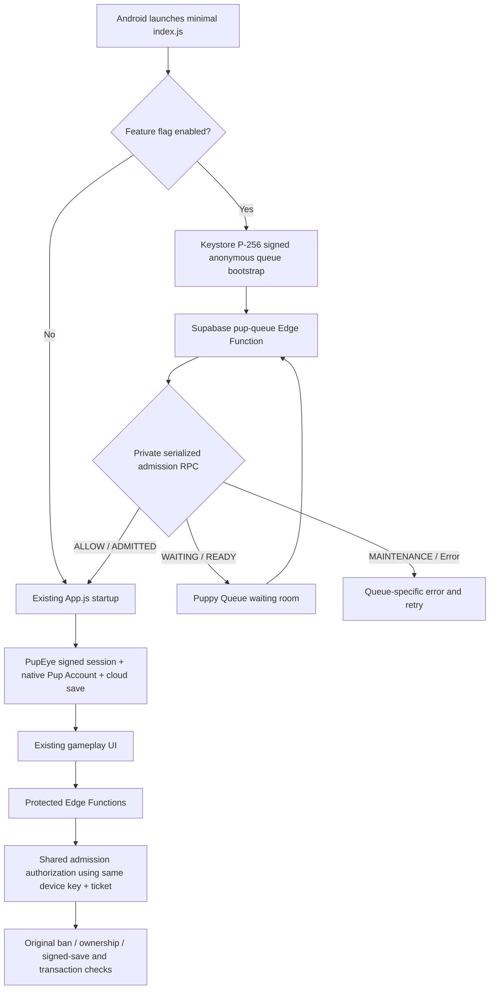

# Puppy Clicker Smart Player Queue — staged implementation

**Status:** Draft implementation, not production ready. **Production mode remains disabled.**
**Branch:** `feat/smart-player-queue-staging`. **Draft PR:** #84.
**Scope:** React Native Android beta + signed PupEye Supabase backend. No production database migrations were applied.

## Architecture

The native bridge generates a minimal hardware-backed P-256 key without registering a player or starting cloud loading. An anonymous ticket is linked to the SHA-256 digest of the public key. The key is later reused by the existing signed PupEye installation envelope. A ticket never logs in a player and never conveys database permissions.

### Server-side controls

- Migration: `supabase/migrations/20261028010000_pup_smart_admission_staging.sql`.
- Private schema: `pup_queue.control`, `pup_queue.tickets`, `pup_queue.audit`.
- Only service-role RPCs; `anon` and `authenticated` cannot call the privileged admission/lease functions. Edge Functions still validate account/session signatures, bans, ownership, save integrity and transactions.
- Capacity row locking serializes **ticket promotions and claims**, while ordinary status queries use a separate read-only RPC without global capacity locks.
- WAITING tickets preserve FIFO `sequence_id`. Short-lived READY and ADMITTED leases are counted against one atomic `slots_used` counter.
- Ticket heartbeat writes are coalesced on Android; public polling is jittered and backed off.
- Maximum capacity, admission rate, automatic thresholds and measured baselines begin **unset**. No fake wait-time estimate is returned.

**Protected paths:** `pup-beta-link` (gameplay, cloud read, bootstrap), `pup-account` (cloud read/write/bootstrap), `pupeye-sync`, `pupeye-transaction` and `pupeye-save-attestation`. Authentication, account recovery and support actions are intentionally exempt from gameplay admission while retaining existing authorization and enforcement.

**Privileged operations:** `pup-queue-admin` requires an independently authenticated active DEVELOPER role. Changes are recorded in queue audit. `pup-queue-monitor` accepts only a secret-authorized trusted collector with fresh timestamped metrics. A missing or stale collector makes automatic mode fail closed to new arrivals.

## Required isolated staging environment

Only the existing production Supabase project was discoverable at review time. **Create a separate staging Supabase project and independent staging Redis; never run burst tests against the existing production project.** Do not clone real accounts, passwords or saves.

Minimum configuration for isolated testing:

| Variable | Location | Requirement |
| --- | --- | --- |
| `EXPO_PUBLIC_PUP_QUEUE_ENABLED=true` | Staging APK build | Opt into pre-startup queue (default false) |
| `EXPO_PUBLIC_PUP_QUEUE_URL` | Staging APK build | Isolated Supabase HTTPS Edge URL ending `/functions/v1/pup-queue` |
| `EXPO_PUBLIC_PUPPY_SUPABASE_KEY` | Staging APK build | Staging publishable key, **never secret/service-role** |
| `PUP_QUEUE_REDIS_REST_URL` | Staging Edge secret | Rate-limiter Redis HTTPS endpoint |
| `PUP_QUEUE_REDIS_REST_TOKEN` | Staging Edge secret | Redis secret (never shipped to APK) |
| `PUP_QUEUE_IP_MAX_PER_MIN` | Staging Edge secret | Measured per-source anti-abuse request ceiling |
| `PUP_QUEUE_DEVICE_MAX_PER_MIN` | Staging Edge secret | Measured per-key anti-abuse request ceiling |
| `PUP_QUEUE_MONITOR_TOKEN` | Staging monitor secret | Strong random collector token (at least 32 bytes) |
| `PUP_QUEUE_MEASURED_BASELINES` | Staging monitor secret | JSON measured workload budgets for six named metrics |

When the queue flag is enabled, the Expo config plugin replaces **all** native PupEye and account Edge URLs with the chosen staging Supabase origin, instead of queuing against staging and authenticating against live production. Verify the generated native project before signing an APK.

### Safe deployment sequence

1. Run `supabase start` and migration+RLS tests **locally/CI**. Confirm the SQL suite and TypeScript type checks pass.
2. Provision independent staging Auth, database, Edge Functions, rate limiter and secrets.
3. Deploy the additive migration in staging. Configure Edge Functions including `pup-queue`, `pup-queue-admin`, `pup-queue-monitor` and every protected existing Edge Function **as one coordinated staging release**.
4. Keep controller `mode='disabled'`. Verify ordinary native startup and gameplay still function, and public Data API roles cannot access the private admission schema.
5. Create measured baseline traffic and confirm startup request, DB connection, edge latency, auth errors, and save sync latency. Configure safe capacity and admission rate from those measurements.
6. Set `manual` mode in staging; verify FIFO, replay resistance, signed device binding, no overbooking, maintenance UI, interrupted reconnects and admin auditing.
7. Establish a trusted metrics collector and tune automatic high/low thresholds and hold time. Automatic mode must never be enabled with a stale or untrusted monitor.
8. Validate Android emulator and physical-device small-screen appearance. Run 100, 500, 1k, 5k, 10k synthetic-arrival tests only against staging with approval and a cost budget.
9. Review all direct API bypass routes and old Google Play client compatibility. Production rollout requires separately approved signed clients and a capacity-backed release plan.

### Test scenarios

- `Mobile/tests/queueAdmission.test.js`: pre-startup module isolation, error safety, native proof, backend guard coverage and bounds.
- `supabase/tests/pup_queue_admission_test.sql`: RLS, service-role-only execution, transparent disabled mode, FIFO capacity and replay idempotence.
- `supabase/functions/tests/pup-queue-test.ts`: signed P-256 proof tampering, safe public responses and missing-admission rejection.
- `scripts/queue-load.mjs`: opt-in, guarded staged burst harness with p50, p95, p99, state and error counts. **No actual load test results are claimed.**

### Security review / remaining blockers

1. **Existing active sessions when automatic protection switches on.** The current first-pass admission gate may reject gameplay writes for an incumbent authenticated session that entered while queuing was disabled. A session-continuity lease / trusted pre-activation allowance must be implemented and tested before production rollout; never lose unsynced rewards.
2. **Anti-bot / source IP integrity.** Redis counters and Keystore binding are in place but per-IP forwarding must be verified as trusted upstream metadata. A sufficiently distributed botnet can create many new keys. Add WAF/challenge and abuse benchmarks before exposing enabled public queue.
3. **Database cost and capacity:** index/SQL correctness in CI is not equivalent to load-test success. Run DB pool saturation, Redis outage, auth failure, network drop and simultaneous-claim tests in staging.
4. **Monitoring:** a privileged metrics-ingestion endpoint exists but there is not yet a deployed independent metrics collector or measured baselines. Automatic mode is disabled by default and fails closed if evidence is stale.
5. **Legacy Android clients:** existing Kotlin Google Play APKs cannot prove possession of a pre-startup ticket. Do not enable admission requirements in production until a compatible staged upgrade strategy and authenticated incumbent-session handling exist.
6. **Admin UI:** developer-only backend controls are present, but a standalone staff dashboard, pagination and approval workflow have not been built.
7. **Queue retention/cost:** ticket cleanup is bounded and opportunistic, but a scheduled staging sweeper and rate/cost budget still need validation.
8. **Production rollback rehearsal:** test mode disable, active-lease reconciliation, Edge rollback, and save write preservation without dropping tables.
9. **Staging credentials and authorization:** code does not carry production service-role keys; environment provisioning is still needed before actual end-to-end tests.

### Rollback

In staging, set controller mode to `disabled` using the authenticated admin API, retain all existing PupEye sessions and cloud-save rows, and revert the coordinated Edge deploy if required. Disable the staging APK flag for the next build. Do not drop tables or revoke accepted player accounts as an emergency response.

**Release gate:** This draft cannot merge to main or receive production traffic until these blockers are cleared, objective capacity measurements are attached, and production rollout is independently authorized.
